# JubNext — Social Impact Analytics Platform
## Production-Grade ER Diagram & Database Schema Specification

> **Reverse-Engineered from Live Codebase** — `/src/lib/syncEngine.js`, all analytics libs, and all API routes.
> **Database Engine:** PostgreSQL (hosted on Neon.tech, serverless pooled connections)
> **Architecture Pattern:** Centralized Analytics Read Store — data is synced from a remote operational API and stored in flattened, analytics-optimised tables.

---

## 1. System Architecture Overview

The platform is a **multi-thematic social impact dashboard** for an NGO (Iampact). It pulls operational beneficiary data from a remote field data collection API (`jubicare.indevconsultancy.com`) and syncs it into a local PostgreSQL database via a background ETL engine (`syncEngine.js`). The dashboard then runs analytical queries against this local store.

### Logical Modules

| Module | Tables | Purpose |
|---|---|---|
| **User & Role Management** | `users`, `roles`, `sync_log` | Authentication, authorization, and ETL audit trail |
| **Geography (Livelihood)** | `skilltracking_state`, `skilltracking_district`, `skilltracking_block`, `skilltracking_village` | Spatial hierarchy for livelihood data |
| **Geography (Health)** | `health_state`, `health_district`, `health_block`, `health_village` | Spatial hierarchy for health data (separate sync source) |
| **Livelihood — Skilling** | `skilltracking_training_stream`, `skilltracking_qualification`, `skilltracking_skill_center`, `skilltracking_batch_list`, `skilltracking_persons`, `skilltracking_monitor` | Tracks beneficiaries through skill training and post-training placement |
| **Livelihood — Enterprise** | `enterprise_support`, `enterprise_support_monitoring` | Tracks micro-enterprise member support and annual profit monitoring |
| **Health** | `health_partner`, `health_disease`, `health_profile_patients`, `health_profile_doctors`, `health_patient_appointments` | Patient registration, clinical appointments, and doctor assignments |
| **Education** | `education_program`, `education_assessment`, `education_muskaan_assessment` | School program sessions, pre/post value assessments, and skill-level assessments |

---

## 2. Module 1 — User & Role Management

### Table: `roles`

> **Rationale:** Defines permission groups. The `thematic` field restricts which dashboard module a user can access, supporting data-domain scoping without per-row ACLs.

| Column Name | Data Type & Constraints | Keys | Description |
|---|---|---|---|
| `id` | `SERIAL PRIMARY KEY` | PK | Auto-incrementing role identifier |
| `name` | `VARCHAR(100) NOT NULL UNIQUE` | UNIQUE | Role label — e.g. `super_admin`, `admin`, `livelihood`, `health`, `education` |
| `thematic` | `VARCHAR(100)` | — | Maps the role to a dashboard thematic domain; `NULL` for super admins |

**Extra Technical Details:**
- `name` carries a `UNIQUE` constraint — enforced in application logic via `SELECT id, name, thematic FROM roles`.
- `thematic` is the RBAC axis: the drilldown API checks `user.thematic !== 'livelihood'` before serving data.

---

### Table: `users`

> **Rationale:** Stores dashboard user accounts. Passwords use Werkzeug-compatible PBKDF2-SHA256 (1M iterations) for compatibility with the legacy Python field app. The `role_id` FK controls both UX routing and API access scoping.

| Column Name | Data Type & Constraints | Keys | Description |
|---|---|---|---|
| `id` | `SERIAL PRIMARY KEY` | PK | Auto-incrementing user identifier |
| `username` | `VARCHAR(100) NOT NULL UNIQUE` | UNIQUE | Login handle |
| `email` | `VARCHAR(255) NOT NULL UNIQUE` | UNIQUE | Email address, also a login identifier |
| `password_hash` | `TEXT NOT NULL` | — | Werkzeug PBKDF2 hash: `pbkdf2:sha256:1000000$salt$hex` |
| `role_id` | `INTEGER NOT NULL` | FK → `roles.id` | Assigned role controlling access scope |
| `is_active` | `SMALLINT NOT NULL DEFAULT 1` | — | Soft-disable flag; `0` = blocked from login |
| `created_at` | `TIMESTAMPTZ NOT NULL` | IDX | Account creation timestamp |

**Cascading:** `ON DELETE RESTRICT` on `role_id` — roles cannot be deleted if users are assigned.

**Extra Technical Details:**
- Composite index recommended on `(email, username)` for fast login lookups.
- `is_active` is checked before JWT issuance; inactive accounts receive a 401 even with valid credentials.

---

### Table: `sync_log`

> **Rationale:** Provides a full operational audit trail for every ETL sync run. Each table-level sync writes one row, enabling the admin sync dashboard to surface success/failure history and diagnose data gaps.

| Column Name | Data Type & Constraints | Keys | Description |
|---|---|---|---|
| `id` | `SERIAL PRIMARY KEY` | PK | Auto-incrementing log entry ID |
| `module` | `VARCHAR(50) NOT NULL` | IDX | Domain module: `education`, `health`, or `livelihood` |
| `table_name` | `VARCHAR(100) NOT NULL` | IDX | Target table that was synced |
| `records_fetched` | `INTEGER DEFAULT 0` | — | Raw record count returned by the upstream API |
| `records_upserted` | `INTEGER DEFAULT 0` | — | Records successfully written to the DB after FK validation |
| `status` | `VARCHAR(20) NOT NULL` | IDX | Sync result: `success` or `error` |
| `error_message` | `VARCHAR(500)` | — | Truncated error string on failure; `NULL` on success |
| `started_at` | `TIMESTAMPTZ NOT NULL` | — | Timestamp when the sync job began |
| `finished_at` | `TIMESTAMPTZ NOT NULL` | — | Timestamp when the sync job completed |

**Extra Technical Details:**
- Composite index on `(module, table_name, started_at DESC)` for the admin UI query pattern.
- No FK references — intentionally standalone; the audit log must survive even if other tables are dropped.

---

## 3. Module 2 — Geography (Livelihood)

> **Rationale:** The livelihood data source uses its own geographic master data, synced separately from the health source. These four tables form a 4-level spatial hierarchy (State → District → Block → Village) allowing all beneficiary analytics to be filtered by location.

### Table: `skilltracking_state`

| Column Name | Data Type & Constraints | Keys | Description |
|---|---|---|---|
| `state_id` | `VARCHAR(50) PRIMARY KEY` | PK | Source system state ID (string, not serial) |
| `state_name` | `VARCHAR(255)` | — | Human-readable state name |
| `status` | `VARCHAR(10)` | — | Active/inactive flag from source |
| `created_at` | `TIMESTAMPTZ` | — | Source record creation timestamp |
| `synced_at` | `TIMESTAMPTZ` | — | Last sync timestamp written by ETL engine |

---

### Table: `skilltracking_district`

| Column Name | Data Type & Constraints | Keys | Description |
|---|---|---|---|
| `district_id` | `VARCHAR(50) PRIMARY KEY` | PK | Source system district ID |
| `district_name` | `VARCHAR(255)` | — | Human-readable district name |
| `state_id` | `VARCHAR(50)` | FK → `skilltracking_state.state_id` | Parent state |
| `status` | `VARCHAR(10)` | — | Active/inactive flag |
| `created_at` | `TIMESTAMPTZ` | — | Source creation timestamp |
| `synced_at` | `TIMESTAMPTZ` | — | Last ETL sync timestamp |

**Cascading:** `ON DELETE CASCADE` — if a state is removed, orphan districts are automatically cleaned up.

---

### Table: `skilltracking_block`

| Column Name | Data Type & Constraints | Keys | Description |
|---|---|---|---|
| `block_id` | `VARCHAR(50) PRIMARY KEY` | PK | Source system block ID |
| `block_name` | `VARCHAR(255)` | — | Block/sub-district name |
| `district_id` | `VARCHAR(50)` | FK → `skilltracking_district.district_id` | Parent district |
| `state_id` | `VARCHAR(50)` | FK → `skilltracking_state.state_id` | Denormalised for direct state-level filtering |
| `status` | `VARCHAR(10)` | — | Active/inactive flag |
| `created_at` | `TIMESTAMPTZ` | — | Source creation timestamp |
| `synced_at` | `TIMESTAMPTZ` | — | Last ETL sync timestamp |

---

### Table: `skilltracking_village`

| Column Name | Data Type & Constraints | Keys | Description |
|---|---|---|---|
| `village_id` | `VARCHAR(50) PRIMARY KEY` | PK | Source system village ID |
| `village_name` | `VARCHAR(255)` | — | Village name |
| `block_id` | `VARCHAR(50)` | FK → `skilltracking_block.block_id` | Parent block |
| `district_id` | `VARCHAR(50)` | FK → `skilltracking_district.district_id` | Denormalised for direct district filtering |
| `state_id` | `VARCHAR(50)` | FK → `skilltracking_state.state_id` | Denormalised for direct state filtering |
| `status` | `VARCHAR(10)` | — | Active/inactive flag |
| `created_at` | `TIMESTAMPTZ` | — | Source creation timestamp |
| `synced_at` | `TIMESTAMPTZ` | — | Last ETL sync timestamp |

---

## 4. Module 3 — Geography (Health)

> **Rationale:** The health system is a separate operational platform with its own geographic master data. Though the structure is identical to the livelihood geography, they are kept in separate tables because they have independent source IDs and sync lifecycles. Merging them would risk ID collisions and complicate sync logic.

### Table: `health_state`

| Column Name | Data Type & Constraints | Keys | Description |
|---|---|---|---|
| `source_id` | `VARCHAR(50) PRIMARY KEY` | PK | Source system state ID |
| `name` | `VARCHAR(255)` | — | State name |
| `del_action` | `VARCHAR(10)` | — | Soft-delete flag from source (`0` = active) |
| `synced_at` | `TIMESTAMPTZ` | — | Last ETL sync timestamp |

---

### Table: `health_district`

| Column Name | Data Type & Constraints | Keys | Description |
|---|---|---|---|
| `source_id` | `VARCHAR(50) PRIMARY KEY` | PK | Source system district ID |
| `name` | `VARCHAR(255)` | — | District name |
| `state_id` | `VARCHAR(50)` | FK → `health_state.source_id` | Parent state |
| `del_action` | `VARCHAR(10)` | — | Soft-delete flag |
| `synced_at` | `TIMESTAMPTZ` | — | Last ETL sync timestamp |

---

### Table: `health_block`

| Column Name | Data Type & Constraints | Keys | Description |
|---|---|---|---|
| `source_id` | `VARCHAR(50) PRIMARY KEY` | PK | Source system block ID |
| `name` | `VARCHAR(255)` | — | Block name |
| `district_id` | `VARCHAR(50)` | FK → `health_district.source_id` | Parent district |
| `del_action` | `VARCHAR(10)` | — | Soft-delete flag |
| `synced_at` | `TIMESTAMPTZ` | — | Last ETL sync timestamp |

---

### Table: `health_village`

| Column Name | Data Type & Constraints | Keys | Description |
|---|---|---|---|
| `source_id` | `VARCHAR(50) PRIMARY KEY` | PK | Source system village ID |
| `name` | `VARCHAR(255)` | — | Village name |
| `block_id` | `VARCHAR(50)` | FK → `health_block.source_id` | Parent block |
| `del_action` | `VARCHAR(10)` | — | Soft-delete flag |
| `synced_at` | `TIMESTAMPTZ` | — | Last ETL sync timestamp |

---

## 5. Module 4 — Livelihood: Skilling

> **Rationale:** This is the core beneficiary journey for the skilling programme. A `person` attends a `batch` at a `skill_center` for a specific `training_stream`. Post-training, their placement and income is tracked in `monitor`. This separation allows the programme to evaluate both **training reach** (persons × batches) and **economic impact** (income change via monitor).

### Table: `skilltracking_training_stream`

| Column Name | Data Type & Constraints | Keys | Description |
|---|---|---|---|
| `stream_id` | `VARCHAR(50) PRIMARY KEY` | PK | Source system trade/stream ID |
| `stream_name` | `VARCHAR(255)` | — | Trade name (e.g. "Kuchhu Training", "Tailoring") |
| `status` | `VARCHAR(10)` | — | Active/inactive flag |
| `created_at` | `TIMESTAMPTZ` | — | Source creation timestamp |
| `synced_at` | `TIMESTAMPTZ` | — | Last ETL sync timestamp |

---

### Table: `skilltracking_qualification`

| Column Name | Data Type & Constraints | Keys | Description |
|---|---|---|---|
| `qualification_id` | `VARCHAR(50) PRIMARY KEY` | PK | Source system qualification ID |
| `qualification_name` | `VARCHAR(255)` | — | Education qualification label (e.g. "10th Pass", "Graduate") |
| `status` | `VARCHAR(10)` | — | Active/inactive flag |
| `created_at` | `TIMESTAMPTZ` | — | Source creation timestamp |
| `synced_at` | `TIMESTAMPTZ` | — | Last ETL sync timestamp |

---

### Table: `skilltracking_skill_center`

| Column Name | Data Type & Constraints | Keys | Description |
|---|---|---|---|
| `center_id` | `VARCHAR(50) PRIMARY KEY` | PK | Source system skill center ID |
| `center_name` | `VARCHAR(255)` | — | Name of the training center |
| `state_id` | `VARCHAR(50)` | FK → `skilltracking_state.state_id` | State where center is located |
| `district_id` | `VARCHAR(50)` | FK → `skilltracking_district.district_id` | District where center is located |
| `status` | `VARCHAR(10)` | — | Active/inactive flag |
| `created_at` | `TIMESTAMPTZ` | — | Source creation timestamp |
| `synced_at` | `TIMESTAMPTZ` | — | Last ETL sync timestamp |

---

### Table: `skilltracking_batch_list`

> **Rationale:** A batch is a cohort of persons trained together at a center for a specific course. It links the training stream (curriculum) to the skill center (facility), enabling batch-level analytics like capacity utilisation (`batch_strength`) and throughput per trade.

| Column Name | Data Type & Constraints | Keys | Description |
|---|---|---|---|
| `batch_id` | `VARCHAR(50) PRIMARY KEY` | PK | Source system batch ID |
| `batch_name` | `VARCHAR(255)` | — | Descriptive batch name |
| `state_id` | `VARCHAR(50)` | FK → `skilltracking_state.state_id` | State of the batch |
| `district_id` | `VARCHAR(50)` | FK → `skilltracking_district.district_id` | District of the batch |
| `course_id` | `VARCHAR(50)` | FK → `skilltracking_training_stream.stream_id` | Trade/course being taught |
| `batch_strength` | `VARCHAR(50)` | — | Target or actual number of trainees |
| `batch_start_date` | `VARCHAR(50)` | IDX | Batch commencement date |
| `batch_end_date` | `VARCHAR(50)` | — | Batch completion date |
| `center_id` | `VARCHAR(50)` | FK → `skilltracking_skill_center.center_id` | Hosting training center |
| `training_id` | `VARCHAR(50)` | FK → `skilltracking_training_stream.stream_id` | Alternative training stream reference |
| `user_id` | `VARCHAR(50)` | — | Field app user who created this record |
| `latitude` | `VARCHAR(50)` | — | GPS latitude of batch location |
| `longitude` | `VARCHAR(50)` | — | GPS longitude of batch location |
| `status` | `VARCHAR(10)` | IDX | Batch status flag |
| `created_at` | `TIMESTAMPTZ` | IDX | Source creation timestamp |
| `updated_at` | `TIMESTAMPTZ` | — | Last update from source |
| `synced_at` | `TIMESTAMPTZ` | — | Last ETL sync timestamp |

**Extra Technical Details:**
- Index on `(state_id, district_id, course_id)` recommended for geographic + trade filter queries.
- `batch_start_date` is stored as `VARCHAR` (source sends mixed formats) — analytics queries use `SUBSTR(..., 1, 4)` for year extraction.

---

### Table: `skilltracking_persons`

> **Rationale:** The central beneficiary entity for the skilling module. Each row is a unique individual who enrolled in a training batch. The `training_stream_id` and `center_id` create analytical shortcuts without requiring a JOIN through `batch_list`, supporting both person-centric and trade-centric queries.

| Column Name | Data Type & Constraints | Keys | Description |
|---|---|---|---|
| `person_id` | `VARCHAR(50) PRIMARY KEY` | PK | Unique beneficiary ID from source system |
| `batch_id` | `VARCHAR(50)` | FK → `skilltracking_batch_list.batch_id` | Enrolled batch |
| `person_name` | `VARCHAR(255)` | — | Full name of the beneficiary |
| `email` | `VARCHAR(255)` | — | Email address |
| `dob` | `VARCHAR(50)` | — | Date of birth (mixed format; used for age calculation via `SUBSTR`) |
| `gender` | `VARCHAR(20)` | IDX | Gender (`M`/`F`/other) |
| `mobile_number` | `VARCHAR(20)` | IDX | Primary contact number |
| `address` | `TEXT` | — | Residential address |
| `qualification_id` | `VARCHAR(50)` | FK → `skilltracking_qualification.qualification_id` | Education level |
| `training_stream_id` | `VARCHAR(50)` | FK → `skilltracking_training_stream.stream_id` | Trade enrolled in (denormalised from batch) |
| `center_id` | `VARCHAR(50)` | FK → `skilltracking_skill_center.center_id` | Training center attended (denormalised) |
| `date_of_completion_of_training` | `VARCHAR(50)` | — | Training completion date |
| `district_id` | `VARCHAR(50)` | FK → `skilltracking_district.district_id` | Beneficiary's home district |
| `state_id` | `VARCHAR(50)` | FK → `skilltracking_state.state_id` | Beneficiary's home state |
| `status` | `VARCHAR(10)` | IDX | Record status flag |
| `user_id` | `VARCHAR(50)` | — | Field app user who registered this person |
| `latitude` | `VARCHAR(50)` | — | GPS latitude at registration |
| `longitude` | `VARCHAR(50)` | — | GPS longitude at registration |
| `created_at` | `TIMESTAMPTZ` | IDX | Source record creation date |
| `synced_at` | `TIMESTAMPTZ` | — | Last ETL sync timestamp |

**Extra Technical Details:**
- Index on `(state_id, district_id, training_stream_id)` is critical — the most common analytics filter combination.
- Index on `(person_name, mobile_number)` supports full-text drilldown search (`ILIKE %q%`).
- `dob` stored as `VARCHAR` — age is computed at query time using `EXTRACT(YEAR)` and `SUBSTR(dob, 1, 4)`.

---

### Table: `skilltracking_monitor`

> **Rationale:** Post-training monitoring records. Each row represents one monitoring visit to a previously-trained person. This enables **Year-over-Year income tracking**, **placement rate calculation**, and **SROI computation** (`SUM(monthly_income) / program_cost`). Multiple rows per person are allowed — representing repeated monitoring contacts over time.

| Column Name | Data Type & Constraints | Keys | Description |
|---|---|---|---|
| `monitoring_id` | `VARCHAR(50) PRIMARY KEY` | PK | Unique monitoring record ID |
| `person_id` | `VARCHAR(50) NOT NULL` | FK → `skilltracking_persons.person_id` | Monitored beneficiary |
| `date_of_monitor` | `VARCHAR(50)` | IDX | Date when monitoring was conducted |
| `work_status` | `VARCHAR(100)` | IDX | Employment status: `Working`, `Not Working`, `Self Employed`, etc. |
| `current_work` | `VARCHAR(255)` | — | Description of current occupation |
| `employment_type` | `VARCHAR(100)` | — | Type of employment: `Salaried`, `Daily Wage`, `Self Employed` |
| `monthly_income` | `VARCHAR(50)` | — | Reported monthly income in INR (stored as string; cast at query time) |
| `remark` | `TEXT` | — | Field officer notes from the monitoring visit |
| `district_id` | `VARCHAR(50)` | FK → `skilltracking_district.district_id` | District where monitoring occurred |
| `state_id` | `VARCHAR(50)` | FK → `skilltracking_state.state_id` | State where monitoring occurred |
| `status` | `VARCHAR(10)` | — | Record status flag |
| `user_id` | `VARCHAR(50)` | — | Field app user who conducted monitoring |
| `created_at` | `TIMESTAMPTZ` | IDX | Source record creation timestamp |
| `synced_at` | `TIMESTAMPTZ` | — | Last ETL sync timestamp |

**Extra Technical Details:**
- `monthly_income` is stored as `VARCHAR` due to source API inconsistencies. Numeric queries use `CASE WHEN monthly_income ~ '^[0-9]+$' THEN monthly_income::integer ELSE 0 END` for safe casting.
- Index on `(person_id, date_of_monitor DESC)` is essential for latest-monitoring-per-person queries.
- Index on `(work_status, state_id, district_id)` supports the placement status dashboard KPI queries.
- `work_status` has no enum constraint — values are free-text from the field app.

---

### Table: `skilltracking_pre_post_master`

> **Rationale:** Stores pre and post-training assessment data aggregates for trainees, tracking trade_name, assessment type, candidates trained, gender split, and placement status per financial year.

| Column Name | Data Type & Constraints | Keys | Description |
|---|---|---|---|
| `pre_post_id` | `VARCHAR(50) PRIMARY KEY` | PK | Unique pre/post record ID |
| `state_id` | `VARCHAR(50)` | FK → `skilltracking_state.state_id` | State ID |
| `district_id` | `VARCHAR(50)` | FK → `skilltracking_district.district_id` | District ID |
| `user_id` | `VARCHAR(50)` | — | User ID |
| `financial_year` | `VARCHAR(50)` | IDX | Financial Year |
| `livelihood` | `VARCHAR(255)` | — | Livelihood Module Type |
| `trade_name` | `VARCHAR(255)` | IDX | Trade Name / Course |
| `candidates_trained` | `VARCHAR(50)` | — | Count of candidates trained |
| `age_group` | `VARCHAR(50)` | — | Age group of candidates |
| `category` | `VARCHAR(100)` | — | Category |
| `male_count` | `VARCHAR(50)` | — | Count of male candidates |
| `female_count` | `VARCHAR(50)` | — | Count of female candidates |
| `placement_status` | `VARCHAR(100)` | — | Count of placed candidates |
| `assessment_type` | `VARCHAR(50)` | IDX | Assessment type: `PRE` or `POST` |
| `created_at` | `TIMESTAMPTZ` | IDX | Creation timestamp |
| `synced_at` | `TIMESTAMPTZ` | — | Last sync timestamp |

---

## 6. Module 5 — Livelihood: Enterprise

> **Rationale:** Separate from the skilling track, enterprise support tracks micro-business members (individuals or SHGs) who receive NGO support. The monitoring table captures annual profit, enabling Year-over-Year financial growth analysis per enterprise member.

### Table: `enterprise_support`

| Column Name | Data Type & Constraints | Keys | Description |
|---|---|---|---|
| `member_id` | `VARCHAR(50) PRIMARY KEY` | PK | Unique enterprise member ID |
| `member_name` | `VARCHAR(255)` | IDX | Name of the enterprise member or group |
| `member_type` | `VARCHAR(100)` | — | Type of enterprise: Individual, SHG, FPO, etc. |
| `member_mode` | `VARCHAR(100)` | — | Mode of engagement |
| `phone_number` | `VARCHAR(20)` | — | Contact number |
| `state_id` | `VARCHAR(50)` | FK → `skilltracking_state.state_id` | Operating state |
| `district_id` | `VARCHAR(50)` | FK → `skilltracking_district.district_id` | Operating district |
| `block_id` | `VARCHAR(50)` | FK → `skilltracking_block.block_id` | Operating block |
| `village_id` | `VARCHAR(50)` | FK → `skilltracking_village.village_id` | Operating village |
| `user_id` | `VARCHAR(50)` | — | Field app user who registered this member |
| `supported_by` | `VARCHAR(255)` | — | Name or ID of the supporting NGO/officer |
| `status` | `VARCHAR(10)` | IDX | Active (`1`) / Inactive (`0`) flag |
| `created_at` | `TIMESTAMPTZ` | IDX | Registration timestamp |
| `synced_at` | `TIMESTAMPTZ` | — | Last ETL sync timestamp |

---

### Table: `enterprise_support_monitoring`

> **Rationale:** Captures one profit-monitoring record per enterprise member per financial year. This is the data foundation for the YoY Profit bar chart and SROI analysis in the Enterprise dashboard. The `JOIN` on `enterprise_support` allows location-based filtering at query time.

| Column Name | Data Type & Constraints | Keys | Description |
|---|---|---|---|
| `monitoring_id` | `VARCHAR(50) PRIMARY KEY` | PK | Unique monitoring record ID |
| `member_id` | `VARCHAR(50) NOT NULL` | FK → `enterprise_support.member_id` | Monitored enterprise member |
| `user_id` | `VARCHAR(50)` | — | Field app user who entered the monitoring data |
| `financial_year` | `VARCHAR(20)` | IDX | Financial year label (e.g. `2023-24`) |
| `profit` | `VARCHAR(50)` | — | Reported annual profit in INR (stored as string; cast at query time) |
| `status` | `VARCHAR(10)` | — | Record status flag |
| `created_at` | `TIMESTAMPTZ` | IDX | Source record creation timestamp |
| `synced_at` | `TIMESTAMPTZ` | — | Last ETL sync timestamp |

**Extra Technical Details:**
- Composite index on `(member_id, financial_year)` critical for YoY aggregation queries.
- `profit` cast pattern: `CASE WHEN profit ~ '^[0-9\\-]+$' THEN profit::bigint ELSE 0 END`.

---

### Table: `enterprise_market_access`

> **Rationale:** Stores information about enterprise market access, tracking agency partnerships, type of market access, and sales generated per state/district.

| Column Name | Data Type & Constraints | Keys | Description |
|---|---|---|---|
| `access_id` | `VARCHAR(50) PRIMARY KEY` | PK | Unique market access record ID |
| `agency_name` | `VARCHAR(255)` | IDX | Name of the agency/partner |
| `sales_generated_average` | `VARCHAR(255)` | — | Average sales generated (e.g. "1 LAKH +") |
| `market_access_type` | `TEXT` | — | Type of market access |
| `state_id` | `VARCHAR(50)` | FK → `skilltracking_state.state_id` | State ID |
| `district_id` | `VARCHAR(50)` | FK → `skilltracking_district.district_id` | District ID |
| `user_id` | `VARCHAR(50)` | — | User ID |
| `financial_year` | `VARCHAR(50)` | IDX | Financial Year |
| `status` | `VARCHAR(10)` | — | Active status |
| `created_at` | `TIMESTAMPTZ` | IDX | Creation timestamp |
| `synced_at` | `TIMESTAMPTZ` | — | Last sync timestamp |

---

## 7. Module 6 — Health

> **Rationale:** The health module tracks the full clinical pathway: a `patient` registered through a `partner` (healthcare provider) visits a `doctor` in an `appointment`. Disease and symptom data from appointments feeds the YoY trend analysis on the Health dashboard.

### Table: `health_partner`

| Column Name | Data Type & Constraints | Keys | Description |
|---|---|---|---|
| `source_id` | `VARCHAR(50) PRIMARY KEY` | PK | Source system partner ID |
| `name` | `VARCHAR(255)` | — | Healthcare partner / facility name |
| `active_status` | `VARCHAR(10)` | IDX | Active/inactive flag (`del_action` from source) |
| `synced_at` | `TIMESTAMPTZ` | — | Last ETL sync timestamp |

---

### Table: `health_disease`

| Column Name | Data Type & Constraints | Keys | Description |
|---|---|---|---|
| `source_id` | `VARCHAR(50) PRIMARY KEY` | PK | Source system disease ID |
| `disease_name` | `VARCHAR(255)` | IDX | Standardised disease label |
| `del_action` | `VARCHAR(10)` | — | Soft-delete flag |
| `synced_at` | `TIMESTAMPTZ` | — | Last ETL sync timestamp |

**Note:** This is a master lookup table. In practice, disease names in appointments are stored as a **comma-separated string** (denormalised), not FK references to this table. This is a known source-system limitation.

---

### Table: `health_profile_patients`

> **Rationale:** The central health beneficiary entity. Each row is a unique patient. The rich demographic data (age, gender, caste, disability, pregnancy) enables the Inclusion analytics KPIs. Village-level geography allows geographic reach mapping.

| Column Name | Data Type & Constraints | Keys | Description |
|---|---|---|---|
| `patient_id` | `VARCHAR(50) PRIMARY KEY` | PK | Unique patient ID from source |
| `user_id` | `VARCHAR(50)` | — | Field app user who registered the patient |
| `full_name` | `VARCHAR(255)` | IDX | Patient's full name |
| `gender` | `VARCHAR(10)` | IDX | Gender (`M`/`F`) |
| `age` | `VARCHAR(10)` | — | Age in years (string; cast at query time for bracket calculations) |
| `age_month` | `VARCHAR(10)` | — | Age in months (for infants) |
| `dob` | `VARCHAR(50)` | — | Date of birth |
| `aadhar_no` | `VARCHAR(20)` | — | National ID number (Aadhaar) |
| `contact_no` | `VARCHAR(20)` | IDX | Primary contact number |
| `partner_id` | `VARCHAR(50)` | FK → `health_partner.source_id` | Associated healthcare partner |
| `state_id` | `VARCHAR(50)` | FK → `health_state.source_id` | Patient's home state |
| `district_id` | `VARCHAR(50)` | FK → `health_district.source_id` | Patient's home district |
| `block_id` | `VARCHAR(50)` | FK → `health_block.source_id` | Patient's home block |
| `village_id` | `VARCHAR(50)` | FK → `health_village.source_id` | Patient's home village |
| `address` | `TEXT` | — | Full address |
| `pin_code` | `VARCHAR(10)` | — | Postal/PIN code |
| `height` | `VARCHAR(10)` | — | Height in cm |
| `weight` | `VARCHAR(10)` | — | Weight in kg |
| `blood_group_id` | `VARCHAR(20)` | — | Blood group reference |
| `caste_id` | `VARCHAR(50)` | IDX | Social community / caste category (used for inclusion analysis) |
| `disability` | `VARCHAR(20)` | IDX | Disability flag (`Yes`/`No`) |
| `female_is_pregnant` | `VARCHAR(10)` | — | Pregnancy status for female patients |
| `self_added` | `VARCHAR(10)` | — | Whether patient self-registered |
| `unique_code` | `VARCHAR(100)` | — | Source-assigned unique patient code |
| `sync_status` | `VARCHAR(20)` | — | Sync state from source system |
| `del_action` | `VARCHAR(10)` | — | Soft-delete flag |
| `created_at` | `TIMESTAMPTZ` | IDX | Registration timestamp |
| `updated_at` | `TIMESTAMPTZ` | — | Last update timestamp |
| `synced_at` | `TIMESTAMPTZ` | — | Last ETL sync timestamp |

**Extra Technical Details:**
- Index on `(state_id, district_id, partner_id, created_at)` for the common analytics filter pattern.
- `caste_id` stores raw values from the source — the dashboard treats it as a community label for the inclusion pie chart.
- CO₂ sustainability metric: `patient_count × CO2_PER_PATIENT_KG` (0.3 kg) — computed at query time, no stored column.

---

### Table: `health_profile_doctors`

| Column Name | Data Type & Constraints | Keys | Description |
|---|---|---|---|
| `source_id` | `VARCHAR(50) PRIMARY KEY` | PK | Source system doctor ID |
| `doctor_name` | `VARCHAR(255)` | — | Doctor's full name |
| `specialization` | `VARCHAR(255)` | — | Medical degree and specialization |
| `state_id` | `VARCHAR(50)` | FK → `health_state.source_id` | Doctor's operating state |
| `district_id` | `VARCHAR(50)` | FK → `health_district.source_id` | Doctor's operating district |
| `partner_id` | `VARCHAR(50)` | FK → `health_partner.source_id` | Associated healthcare partner |
| `del_action` | `VARCHAR(10)` | — | Soft-delete flag |
| `synced_at` | `TIMESTAMPTZ` | — | Last ETL sync timestamp |

---

### Table: `health_patient_appointments`

> **Rationale:** The transaction record of the health module. Each row is one clinical visit. The `profile_patient_id` FK links back to the patient. Disease and symptom data are stored as **comma-separated strings** (serialised from JSON arrays in the source API) — a denormalisation choice that trades query flexibility for ETL simplicity. The `repeat patient` KPI is computed by counting patients with `COUNT(appointments) > 1`.

| Column Name | Data Type & Constraints | Keys | Description |
|---|---|---|---|
| `appointment_id` | `VARCHAR(50) PRIMARY KEY` | PK | Unique appointment ID |
| `profile_patient_id` | `VARCHAR(50) NOT NULL` | FK → `health_profile_patients.patient_id` | The attending patient |
| `symtom` | `TEXT` | IDX | Comma-separated symptom names (serialised from JSON array) |
| `bp_lower` | `VARCHAR(10)` | — | Diastolic blood pressure |
| `bp_upper` | `VARCHAR(10)` | — | Systolic blood pressure |
| `sugar` | `VARCHAR(20)` | — | Blood sugar level |
| `temperature` | `VARCHAR(10)` | — | Body temperature |
| `blood_oxygen_level` | `VARCHAR(10)` | — | SpO₂ reading |
| `pulse` | `VARCHAR(10)` | — | Pulse rate |
| `hemoglobin` | `VARCHAR(10)` | — | Haemoglobin level |
| `disease` | `TEXT` | IDX | Comma-separated disease names (serialised from JSON array) |
| `fees_free_or_paid` | `VARCHAR(20)` | — | Whether the consultation was free or paid |
| `paid_amount` | `VARCHAR(20)` | — | Amount paid (if applicable) |
| `assigned_doctor_id` | `VARCHAR(50)` | FK → `health_profile_doctors.source_id` | Attending doctor |
| `doctor_remarks` | `TEXT` | — | Clinical notes by the doctor |
| `patient_remark` | `TEXT` | — | Remarks from the patient |
| `is_doctor_done` | `VARCHAR(10)` | — | Flag: whether doctor consultation is completed |
| `is_doctor_done_date` | `VARCHAR(50)` | — | Date doctor marked the case complete |
| `prescription` | `TEXT` | — | Comma-separated prescribed medicine names |
| `pharmacist_prescription` | `TEXT` | — | Pharmacist's dispensing notes |
| `is_pharmacist_done` | `VARCHAR(10)` | — | Flag: whether pharmacist has dispensed medicines |
| `pharmacist_done_date` | `VARCHAR(50)` | — | Date pharmacist marked case complete |
| `medicine_given` | `TEXT` | — | Medicines actually dispensed |
| `state_id` | `VARCHAR(50)` | FK → `health_state.source_id` | State of the appointment |
| `district_id` | `VARCHAR(50)` | FK → `health_district.source_id` | District of the appointment |
| `partner_id` | `VARCHAR(50)` | FK → `health_partner.source_id` | Facility partner |
| `sync_status` | `VARCHAR(20)` | — | Sync state from source |
| `created_at` | `TIMESTAMPTZ` | IDX | Appointment creation timestamp |
| `synced_at` | `TIMESTAMPTZ` | — | Last ETL sync timestamp |

**Extra Technical Details:**
- Index on `(profile_patient_id, created_at DESC)` for repeat-patient detection queries.
- Index on `(state_id, district_id, partner_id)` for dashboard filter performance.
- `disease` and `symtom` fields are parsed in the ETL engine from JSON arrays to comma-joined strings before upsert.
- Financial savings KPIs: `total_appointments × ₹150 (tariff saved)` and `× ₹200 (wage loss saved)`.

---

## 8. Module 7 — Education

> **Rationale:** Education tracks two distinct programme types: (1) structured school sessions (`education_program`) and (2) student-level assessments — both value-based (`education_assessment`) and skill-level (`education_muskaan_assessment`). These three tables serve different analytics dimensions: reach (sessions), quality (scores), and holistic development (skill levels).

### Table: `education_program`

> **Rationale:** Each row is one programme session (not a student record). It tracks which school was visited, which activity was conducted, and how many students participated. Analytics aggregate these into session counts and student reach per academic year and per programme.

| Column Name | Data Type & Constraints | Keys | Description |
|---|---|---|---|
| `program_id` | `VARCHAR(50) PRIMARY KEY` | PK | Unique programme session ID |
| `program_name` | `VARCHAR(255)` | IDX | Programme name (e.g. "Life Skills", "Muskaan") |
| `activity_type` | `VARCHAR(255)` | IDX | Type of activity conducted |
| `school_name` | `VARCHAR(255)` | — | Name of the school visited |
| `school_id` | `VARCHAR(50)` | IDX | Source school ID for filtering |
| `state_id` | `VARCHAR(50)` | FK → `skilltracking_state.state_id` | State of the school |
| `district_id` | `VARCHAR(50)` | FK → `skilltracking_district.district_id` | District of the school |
| `block_id` | `VARCHAR(50)` | FK → `skilltracking_block.block_id` | Block of the school |
| `village_id` | `VARCHAR(50)` | FK → `skilltracking_village.village_id` | Village of the school |
| `academic_year` | `VARCHAR(20)` | IDX | Academic year label (e.g. `2023-24`) |
| `activity_date` | `TIMESTAMPTZ` | IDX | Date of the session |
| `student_count` | `INTEGER` | — | Number of students who participated |
| `status` | `VARCHAR(10)` | — | Session status flag |
| `created_at` | `TIMESTAMPTZ` | IDX | Source creation timestamp |
| `synced_at` | `TIMESTAMPTZ` | — | Last ETL sync timestamp |

**Note:** Education uses the Livelihood geography tables (`skilltracking_*`) — there is no separate `education_state` table.

---

### Table: `education_assessment`

> **Rationale:** Captures student-level pre/post score data for value-based interventions (e.g. empathy, gender sensitivity). The `value_name` groups assessments by the specific value being measured, enabling the Pre/Post Comparison bar chart. Multiple students can have assessments for the same value in the same programme.

| Column Name | Data Type & Constraints | Keys | Description |
|---|---|---|---|
| `assessment_id` | `VARCHAR(50) PRIMARY KEY` | PK | Unique assessment record ID |
| `program_id` | `VARCHAR(50)` | FK → `education_program.program_id` | Associated programme session |
| `school_id` | `VARCHAR(50)` | IDX | School where assessment was conducted |
| `student_id` | `VARCHAR(50)` | IDX | Student identifier from source system |
| `value_name` | `VARCHAR(255)` | IDX | The specific value assessed (e.g. "Respect", "Empathy") |
| `pre_score` | `NUMERIC(5,2)` | — | Score before the intervention |
| `post_score` | `NUMERIC(5,2)` | — | Score after the intervention |
| `assessment_date` | `TIMESTAMPTZ` | — | Date assessment was conducted |
| `academic_year` | `VARCHAR(20)` | IDX | Academic year of the assessment |
| `created_at` | `TIMESTAMPTZ` | — | Source creation timestamp |
| `synced_at` | `TIMESTAMPTZ` | — | Last ETL sync timestamp |

---

### Table: `education_muskaan_assessment`

> **Rationale:** The "Muskaan" (Joy/Smile) programme uses a skill-level assessment model rather than numeric scores. Pre/post *levels* (e.g. "Beginner" → "Intermediate") track holistic child development. This warrants a separate table because the schema is fundamentally different from the numeric score model in `education_assessment`.

| Column Name | Data Type & Constraints | Keys | Description |
|---|---|---|---|
| `assessment_id` | `VARCHAR(50) PRIMARY KEY` | PK | Unique Muskaan assessment record ID |
| `school_id` | `VARCHAR(50)` | IDX | School where assessment was conducted |
| `student_id` | `VARCHAR(50)` | IDX | Student identifier |
| `skill_area` | `VARCHAR(255)` | IDX | Skill domain assessed (e.g. "Communication", "Life Skills") |
| `pre_level` | `VARCHAR(100)` | — | Skill level before programme (e.g. "Beginner") |
| `post_level` | `VARCHAR(100)` | — | Skill level after programme (e.g. "Proficient") |
| `assessment_date` | `TIMESTAMPTZ` | — | Date of assessment |
| `academic_year` | `VARCHAR(20)` | IDX | Academic year |
| `created_at` | `TIMESTAMPTZ` | — | Source creation timestamp |
| `synced_at` | `TIMESTAMPTZ` | — | Last ETL sync timestamp |

---

## 9. Relationships Summary Table

| Relationship | From Table | To Table | Type | Shared Key | Cascade Rule |
|---|---|---|---|---|---|
| User belongs to Role | `users` | `roles` | N:1 | `users.role_id → roles.id` | RESTRICT on delete |
| District in State (livelihood) | `skilltracking_district` | `skilltracking_state` | N:1 | `district.state_id → state.state_id` | CASCADE on delete |
| Block in District (livelihood) | `skilltracking_block` | `skilltracking_district` | N:1 | `block.district_id → district.district_id` | CASCADE |
| Village in Block (livelihood) | `skilltracking_village` | `skilltracking_block` | N:1 | `village.block_id → block.block_id` | CASCADE |
| District in State (health) | `health_district` | `health_state` | N:1 | `district.state_id → state.source_id` | CASCADE |
| Block in District (health) | `health_block` | `health_district` | N:1 | `block.district_id → district.source_id` | CASCADE |
| Village in Block (health) | `health_village` | `health_block` | N:1 | `village.block_id → block.source_id` | CASCADE |
| Batch in Training Stream | `skilltracking_batch_list` | `skilltracking_training_stream` | N:1 | `batch.course_id → stream.stream_id` | SET NULL |
| Batch at Skill Center | `skilltracking_batch_list` | `skilltracking_skill_center` | N:1 | `batch.center_id → center.center_id` | SET NULL |
| Person in Batch | `skilltracking_persons` | `skilltracking_batch_list` | N:1 | `person.batch_id → batch.batch_id` | RESTRICT |
| Person enrolled in Trade | `skilltracking_persons` | `skilltracking_training_stream` | N:1 | `person.training_stream_id → stream.stream_id` | SET NULL |
| Person has Qualification | `skilltracking_persons` | `skilltracking_qualification` | N:1 | `person.qualification_id → qualification.qualification_id` | SET NULL |
| Monitor record for Person | `skilltracking_monitor` | `skilltracking_persons` | N:1 | `monitor.person_id → person.person_id` | CASCADE |
| Enterprise member monitored | `enterprise_support_monitoring` | `enterprise_support` | N:1 | `monitoring.member_id → member.member_id` | CASCADE |
| Patient registered with Partner | `health_profile_patients` | `health_partner` | N:1 | `patient.partner_id → partner.source_id` | SET NULL |
| Patient in Village | `health_profile_patients` | `health_village` | N:1 | `patient.village_id → village.source_id` | SET NULL |
| Doctor at Partner | `health_profile_doctors` | `health_partner` | N:1 | `doctor.partner_id → partner.source_id` | SET NULL |
| Appointment for Patient | `health_patient_appointments` | `health_profile_patients` | N:1 | `appt.profile_patient_id → patient.patient_id` | CASCADE |
| Appointment assigned to Doctor | `health_patient_appointments` | `health_profile_doctors` | N:1 | `appt.assigned_doctor_id → doctor.source_id` | SET NULL |
| Assessment for Programme | `education_assessment` | `education_program` | N:1 | `assessment.program_id → program.program_id` | CASCADE |
| Programme in Geography | `education_program` | `skilltracking_state/district` | N:1 | `program.state_id / district_id` | SET NULL |

---

## 10. Mermaid.js ER Diagram

```mermaid
erDiagram
    roles {
        int id PK
        varchar name
        varchar thematic
    }
    users {
        int id PK
        varchar username
        varchar email
        text password_hash
        int role_id FK
        smallint is_active
        timestamptz created_at
    }
    sync_log {
        int id PK
        varchar module
        varchar table_name
        int records_fetched
        int records_upserted
        varchar status
        varchar error_message
        timestamptz started_at
        timestamptz finished_at
    }

    skilltracking_state {
        varchar state_id PK
        varchar state_name
        varchar status
    }
    skilltracking_district {
        varchar district_id PK
        varchar district_name
        varchar state_id FK
    }
    skilltracking_block {
        varchar block_id PK
        varchar block_name
        varchar district_id FK
        varchar state_id FK
    }
    skilltracking_village {
        varchar village_id PK
        varchar village_name
        varchar block_id FK
        varchar district_id FK
    }
    skilltracking_training_stream {
        varchar stream_id PK
        varchar stream_name
        varchar status
    }
    skilltracking_qualification {
        varchar qualification_id PK
        varchar qualification_name
    }
    skilltracking_skill_center {
        varchar center_id PK
        varchar center_name
        varchar state_id FK
        varchar district_id FK
    }
    skilltracking_batch_list {
        varchar batch_id PK
        varchar batch_name
        varchar course_id FK
        varchar center_id FK
        varchar state_id FK
        varchar district_id FK
        varchar batch_start_date
        varchar batch_end_date
        varchar batch_strength
    }
    skilltracking_persons {
        varchar person_id PK
        varchar batch_id FK
        varchar person_name
        varchar gender
        varchar mobile_number
        varchar dob
        varchar training_stream_id FK
        varchar qualification_id FK
        varchar center_id FK
        varchar state_id FK
        varchar district_id FK
        timestamptz created_at
    }
    skilltracking_monitor {
        varchar monitoring_id PK
        varchar person_id FK
        varchar work_status
        varchar monthly_income
        varchar employment_type
        varchar date_of_monitor
        varchar state_id FK
        varchar district_id FK
    }
    enterprise_support {
        varchar member_id PK
        varchar member_name
        varchar member_type
        varchar phone_number
        varchar state_id FK
        varchar district_id FK
        varchar block_id FK
        varchar village_id FK
        varchar status
    }
    enterprise_support_monitoring {
        varchar monitoring_id PK
        varchar member_id FK
        varchar financial_year
        varchar profit
        timestamptz created_at
    }
    skilltracking_pre_post_master {
        varchar pre_post_id PK
        varchar state_id FK
        varchar district_id FK
        varchar user_id
        varchar financial_year
        varchar livelihood
        varchar trade_name
        varchar candidates_trained
        varchar age_group
        varchar category
        varchar male_count
        varchar female_count
        varchar placement_status
        varchar assessment_type
        timestamptz created_at
    }
    enterprise_market_access {
        varchar access_id PK
        varchar agency_name
        varchar sales_generated_average
        text market_access_type
        varchar state_id FK
        varchar district_id FK
        varchar user_id
        varchar financial_year
        varchar status
        timestamptz created_at
    }

    health_state {
        varchar source_id PK
        varchar name
    }
    health_district {
        varchar source_id PK
        varchar name
        varchar state_id FK
    }
    health_block {
        varchar source_id PK
        varchar name
        varchar district_id FK
    }
    health_village {
        varchar source_id PK
        varchar name
        varchar block_id FK
    }
    health_partner {
        varchar source_id PK
        varchar name
        varchar active_status
    }
    health_disease {
        varchar source_id PK
        varchar disease_name
    }
    health_profile_patients {
        varchar patient_id PK
        varchar full_name
        varchar gender
        varchar age
        varchar caste_id
        varchar disability
        varchar partner_id FK
        varchar state_id FK
        varchar district_id FK
        varchar block_id FK
        varchar village_id FK
        timestamptz created_at
    }
    health_profile_doctors {
        varchar source_id PK
        varchar doctor_name
        varchar specialization
        varchar partner_id FK
        varchar state_id FK
        varchar district_id FK
    }
    health_patient_appointments {
        varchar appointment_id PK
        varchar profile_patient_id FK
        varchar assigned_doctor_id FK
        text disease
        text symtom
        text prescription
        varchar partner_id FK
        varchar state_id FK
        varchar district_id FK
        timestamptz created_at
    }

    education_program {
        varchar program_id PK
        varchar program_name
        varchar activity_type
        varchar school_id
        varchar school_name
        varchar state_id FK
        varchar district_id FK
        varchar academic_year
        int student_count
        timestamptz activity_date
    }
    education_assessment {
        varchar assessment_id PK
        varchar program_id FK
        varchar school_id
        varchar student_id
        varchar value_name
        numeric pre_score
        numeric post_score
        varchar academic_year
    }
    education_muskaan_assessment {
        varchar assessment_id PK
        varchar school_id
        varchar student_id
        varchar skill_area
        varchar pre_level
        varchar post_level
        varchar academic_year
    }

    roles ||--o{ users : "role_id"
    skilltracking_state ||--o{ skilltracking_district : "state_id"
    skilltracking_district ||--o{ skilltracking_block : "district_id"
    skilltracking_block ||--o{ skilltracking_village : "block_id"
    skilltracking_state ||--o{ skilltracking_skill_center : "state_id"
    skilltracking_district ||--o{ skilltracking_skill_center : "district_id"
    skilltracking_training_stream ||--o{ skilltracking_batch_list : "course_id"
    skilltracking_skill_center ||--o{ skilltracking_batch_list : "center_id"
    skilltracking_state ||--o{ skilltracking_batch_list : "state_id"
    skilltracking_batch_list ||--o{ skilltracking_persons : "batch_id"
    skilltracking_training_stream ||--o{ skilltracking_persons : "training_stream_id"
    skilltracking_qualification ||--o{ skilltracking_persons : "qualification_id"
    skilltracking_state ||--o{ skilltracking_persons : "state_id"
    skilltracking_district ||--o{ skilltracking_persons : "district_id"
    skilltracking_persons ||--o{ skilltracking_monitor : "person_id"
    skilltracking_state ||--o{ enterprise_support : "state_id"
    skilltracking_district ||--o{ enterprise_support : "district_id"
    skilltracking_block ||--o{ enterprise_support : "block_id"
    skilltracking_village ||--o{ enterprise_support : "village_id"
    enterprise_support ||--o{ enterprise_support_monitoring : "member_id"
    skilltracking_state ||--o{ skilltracking_pre_post_master : "state_id"
    skilltracking_district ||--o{ skilltracking_pre_post_master : "district_id"
    skilltracking_state ||--o{ enterprise_market_access : "state_id"
    skilltracking_district ||--o{ enterprise_market_access : "district_id"
    health_state ||--o{ health_district : "state_id"
    health_district ||--o{ health_block : "district_id"
    health_block ||--o{ health_village : "block_id"
    health_partner ||--o{ health_profile_patients : "partner_id"
    health_state ||--o{ health_profile_patients : "state_id"
    health_district ||--o{ health_profile_patients : "district_id"
    health_block ||--o{ health_profile_patients : "block_id"
    health_village ||--o{ health_profile_patients : "village_id"
    health_partner ||--o{ health_profile_doctors : "partner_id"
    health_profile_patients ||--o{ health_patient_appointments : "profile_patient_id"
    health_profile_doctors ||--o{ health_patient_appointments : "assigned_doctor_id"
    health_partner ||--o{ health_patient_appointments : "partner_id"
    skilltracking_state ||--o{ education_program : "state_id"
    skilltracking_district ||--o{ education_program : "district_id"
    education_program ||--o{ education_assessment : "program_id"
```

---

## 11. Key Architectural Notes & Design Decisions

### 1. Dual Geography System
The platform has two independent geographic hierarchies (`skilltracking_*` and `health_*`) because the livelihood and health data are sourced from completely separate operational systems with non-overlapping IDs. Merging them would require complex deduplication and risk ID collisions during upserts.

### 2. Education Reuses Livelihood Geography
The education module does not have its own geography tables — it reuses `skilltracking_state/district/block/village`. This is because both are managed by the same NGO operations team and share the same administrative geography source.

### 3. String-Typed IDs Throughout
Nearly all primary and foreign keys are `VARCHAR(50)` rather than `BIGINT SERIAL`. This is a deliberate choice: the source API returns IDs as strings (sometimes padded, sometimes prefixed) and coercing them to integers at ingest would cause silent data loss. The tradeoff is slightly larger index sizes.

### 4. Denormalised Numeric Fields as VARCHAR
Fields like `monthly_income`, `profit`, `age`, `batch_strength`, and all vitals in appointments are stored as `VARCHAR`. The source API returns mixed formats (empty strings, non-numeric text, JSON fragments). Safe numeric casting is done at the analytics query layer using PostgreSQL regex guards: `CASE WHEN field ~ '^[0-9]+$' THEN field::integer ELSE 0 END`.

### 5. ETL FK Validation
The `syncEngine.js` runs a pre-flight FK validation check before every batch upsert — querying `information_schema.table_constraints` to find all FK constraints on the target table, then filtering out records whose FK values don't exist in the parent table. This prevents constraint violations without disabling FK enforcement at the DB level.

### 6. Upsert Strategy
All data ingestion uses `INSERT ... ON CONFLICT (unique_field) DO UPDATE SET ...` — an idempotent upsert pattern. Running the sync multiple times is safe; only changed fields are overwritten. The `synced_at` column is always updated to mark the last successful sync.
